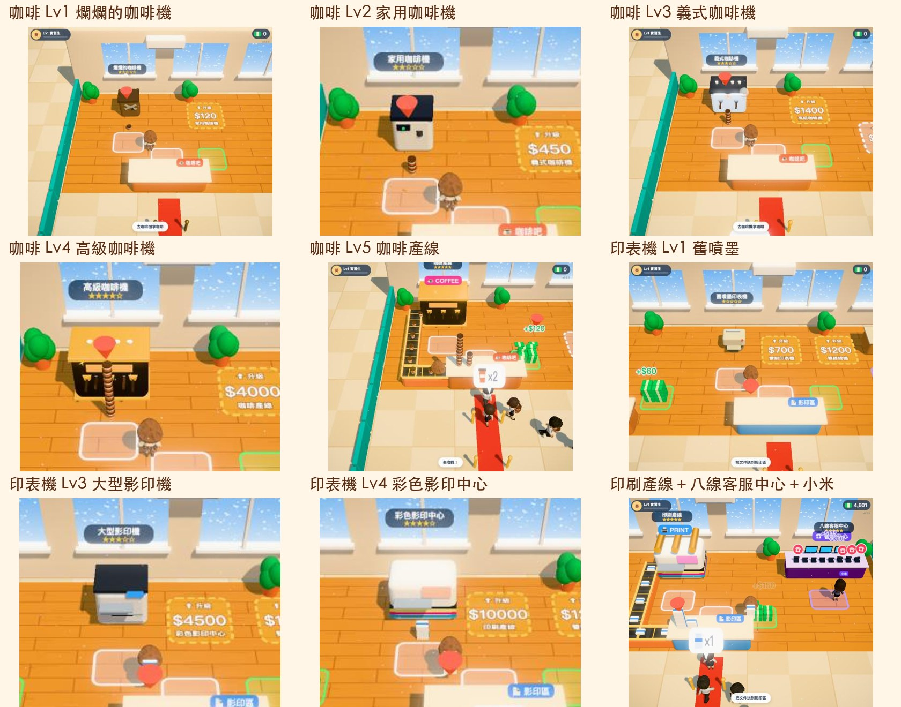
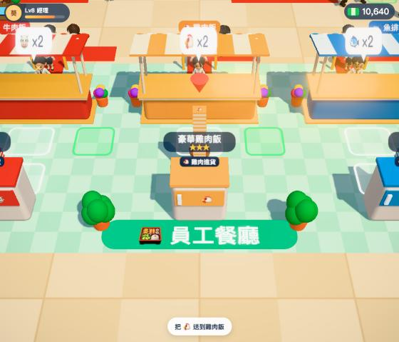
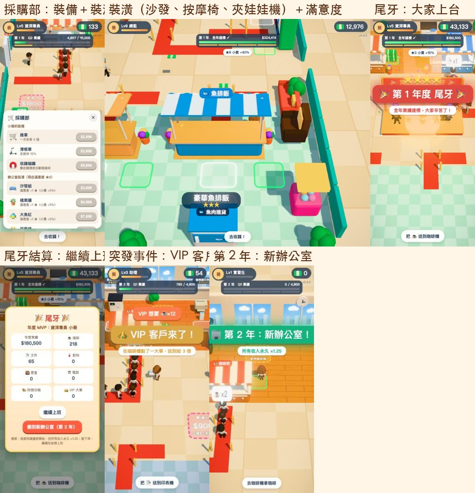
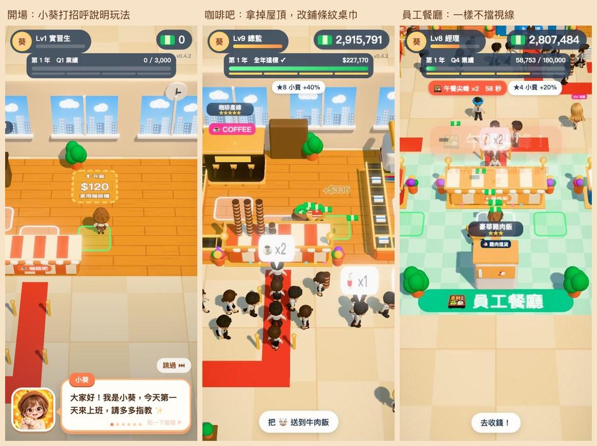
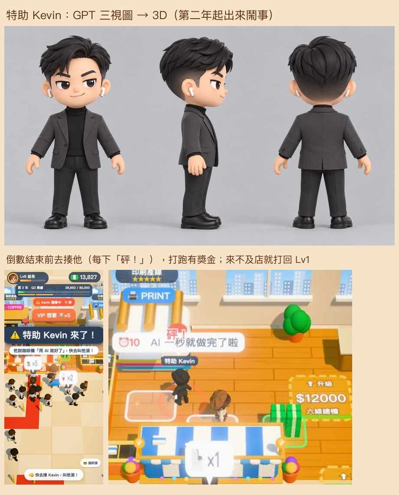
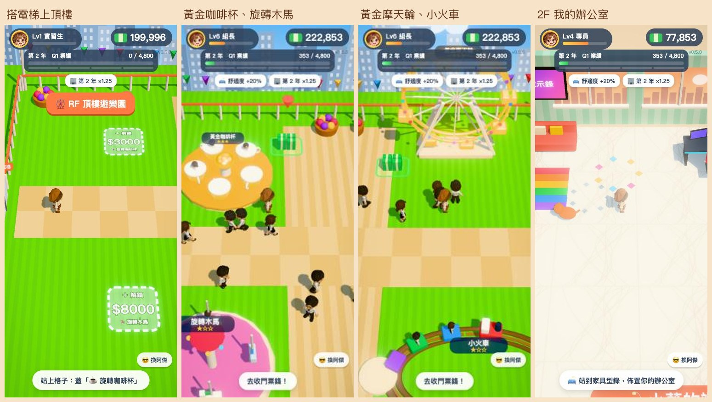
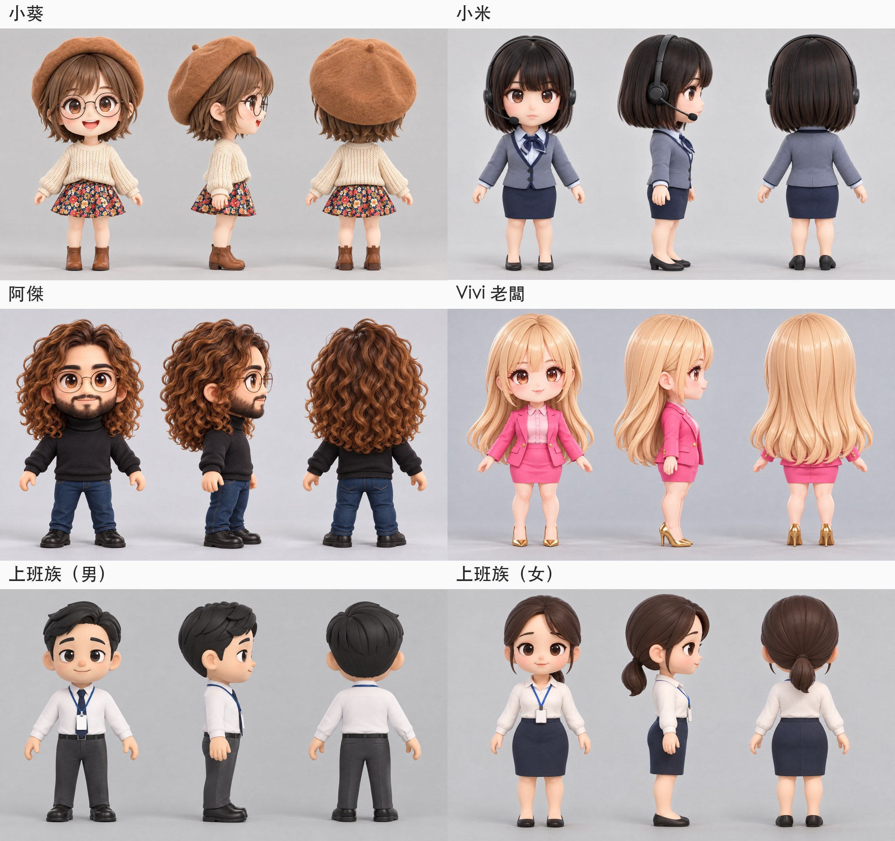
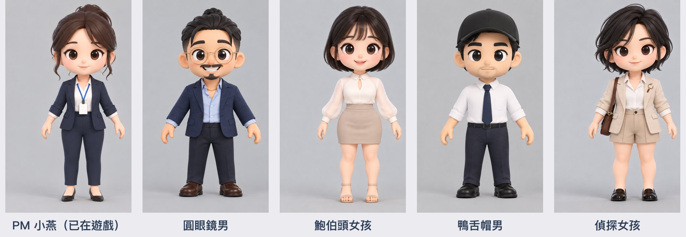

# 上班啟示錄

新人小葵報到第一天，什麼雜事都要做。煮咖啡、印文件、幫販賣機和員工餐廳補貨、接電話，把破爛茶水間一路升級成產線！

**線上玩：** https://pokemonida99.github.io/office-apocalypse/

📖 **[製作流程](製作流程.md)**：從廣告參考、GPT 畫角色三視圖、轉 3D 綁骨架、遊戲一路擴增，到宣傳影片和跑酷橫向捲軸《打卡衝衝衝》。

手機直式最順。拖曳畫面移動（電腦可用方向鍵／WASD）。免費、不用登入、沒有儲值或等待時間。

**離線玩：** 連網打開一次之後，沒網路也能玩（存進手機的快取）。

**加到手機主畫面：** 封面可以挑四款圖示（小葵、小米、阿傑、Vivi），選好後 iPhone 用 Safari「分享 → 加入主畫面」，Android 用選單「加到主畫面」。

## 介面（v0.7）

跟 GPT 討論後定案：**A 員工證／打卡鐘**當骨架（標題是掛著吊繩的員工識別證、按「打卡上班」開工、錢是收據條、年度進度是 Q1～Q4 打卡卡、提示是便利貼），**B 綜藝字卡**只用在事件瞬間（升職、季度達標、Kevin、VIP、黑財神…的斜切黑底大字），**C 手帳**留給故事收藏（之後的年度短片、離職結局）。字型是 Noto Sans TC＋Bungee（SIL OFL，`fonts/`，只留遊戲用到的字；改了文字要跑 `python3 tools/build_font.py`）。樣式在 `css/a4.css`。

- **開場**：先出現 START 畫面（點一下才進標題，順便開聲音），標題的員工識別證會從上面掉下來晃幾下；從遊戲裡回標題不會再看到 START。
- **片頭**：第一次按「打卡上班」播約 4.8 秒的片頭（遊戲 3D 模型即時演出：08:59 快遲到 → 小葵抱水桶衝 → 阿傑拉推車 → 紙張擦鏡 → 標題＋09:00 打卡章，有音效），可跳過，設定或選單裡可重看。
- **修改歷程**：標題畫面最下面「📝 修改歷程」看每一版改了什麼（`js/changelog.js`，每次改版在最上面加一筆）。
- **配樂**（Suno 生成，`audio/`）：標題畫面「Stapler Symphony」（封面點一下開始放）、上班中「Cozy Office Loop」（開工後循環）。換曲交叉淡化、循環頭尾交疊、開選單或小遊戲時自動變小聲、切到別的 App 會暫停；設定與選單可調音樂音量。
- **存檔**：三格存檔，每格是一輪獨立的公司人生（小葵、阿傑各自分開存）；可開新檔、切換、刪除（問兩次）。
- **往年回顧**：玩過的年份可以從那一年開頭重玩（加成照那年算），不會覆蓋主線，賺的錢也不帶回主線；選單可「結束回顧」回主線。

- **咖啡機／印表機**：做好的貨堆在出貨口 → 站進白框背起來 → 送到櫃台 → 排隊的同事拿到就付錢 → 去綠框收錢。
- **販賣機、員工餐廳（牛肉飯／雞肉飯／魚排飯）**：進貨箱會自己到貨，搬去補貨，同事排隊來買。
- **電話總機**：桌子在前面，接電話要繞到桌子後面站進紫色框（面向大家），響的電話一通一通接，一通 $100 起（遊戲裡的電話完全不提醒，不響鈴、不冒泡泡、接起來也沒聲音）。升級格在接電話位置的右邊。
- **小米的接電話挑戰**：封面就能直接玩，遊戲裡站在總機旁邊也會出現按鈕。響了就點；金色 👑 是老闆（3 分），紫色 🤖 是 Kevin 的 AI 推銷（別接！）；漏接會斷連擊，越後面響得越快；玩到一半可以按右上 ⏸ 暫停（繼續／重來／選關／離開）。共三關，每關各記最佳紀錄、獎金越後面越多：
  - **第 1 關 新人總機**：3×3、30 秒。拿 25 分開第 2 關。
  - **第 2 關 午休搶線**：3×4、更快，多了 😡 客訴電話（連點兩下安撫，2 分）。拿 35 分開第 3 關。
  - **第 3 關 月底地獄**：4×4、35 秒、最快、Kevin 更多，還有 🧧 黑財神來電（點到 4 秒內分數 ×2）。升到六線、八線會蓋玻璃辦公室給小米。
- **踩格子**：金色格子升級設施、白色格子解鎖新區域、粉紅格子請人。站上去錢會一點一點付進去。
- **升級**：咖啡機、印表機、電話總機 5 級（第 5 級是產線或八線客服中心），販賣機和三個攤位 3 級。
- **操控阿傑老鳥**：封面另一顆按鈕。阿傑素質全滿（職等、推車、滑板車、磁鐵都最高），所有店一開始就開好，小葵改坐設計部畫圖；存檔跟小葵分開，遊戲裡右下角「存檔離開・換小葵」隨時換回來。
- **開場**：第一次玩小葵會用對話框跟大家打招呼、說明玩法（可跳過）。
- **升職**：小葵做事會累積經驗，從實習生一路升到總監；每升一級一次背更多、走更快（總監比實習生快 68%）。
- **年度業績**：畫面上方的進度條分 Q1～Q4，每季達標發獎金、解鎖新東西（Q1 採購部、Q2 突發事件、Q3 高級裝潢）；全年達標辦**尾牙**，小葵領年度 MVP，可以選擇繼續上班，或搬到新辦公室（重新開始，收入永久加成、目標也變大，每年換一種配色）。選了繼續上班也沒關係：之後畫面上方進度條下面會多一顆「🚚 搬到新辦公室」按鈕，玩夠了隨時按（會先跳確認）。
- **採購部**：買小葵的裝備（推車、滑板車、收錢磁鐵三級：小範圍 → 大一點 → 全場，第三級錢直接入帳、不再有鈔票飛過來，畫面比較清爽也比較不卡）和辦公室裝潢（沙發、植栽牆、魚缸、按摩椅、招財貓、夾娃娃機、獎盃櫃、鋼琴），每件裝潢讓員工滿意度 +1 ★，同事多給 5% 小費。
- **飲水機（Q1 起）**：右邊兩台飲水機會慢慢喝光，去桶裝水堆背一桶倒上去（一次 $80）；每台沒水小費少 5%。
- **搭電梯（第二年起）**：走到左邊電梯門口選樓層。1F 照常營業，上樓時 1F 也繼續賺錢（Kevin 來了要趕快下樓）。
  - **RF 頂樓遊樂園**：旋轉咖啡杯、旋轉木馬、摩天輪、小火車，踩格子蓋、各升 3 級（黃金版）。同事上來排隊、坐一趟付門票，去收錢。
  - **2F 辦公室**：房間大小 老闆 1：特助 0.6：小葵 0.2：阿傑 0.2。前排整排是 **Vivi 老闆辦公室**（紅地毯、大辦公桌、獎盃架、高爾夫推桿果嶺、魚缸、招財貓、名畫、沙發、酒櫃、按摩椅、地球儀、保險箱）；後排左到右是**小葵的小辦公室**（唯一能用家具型錄布置：地板、牆壁、桌椅、沙發、地毯、植物、牆上、燈、寵物，每買一件舒適度 +2%，全部收入加成）、**阿傑的座位**（就一台筆電）、第 2 年起的**特助 Kevin 科技辦公室**（多螢幕、伺服器機櫃、「AI 就好」霓虹燈）。2F 搬家不重置，以前買過的阿傑家具照原價退錢。Vivi 偶爾會搭電梯上來自己的辦公室待一下。（下一步：往《動物森友會》的方向重做 2F，提案在 `work/gpt/ac/`。）
- **特助 Kevin（第二年起）**：Kevin 會從電梯走出來，站到一家店旁邊說「這個用 AI 就好了」，頭上倒數 15 秒。趕快走過去撞他（每碰一下揍一拳，5 拳打跑），打跑有獎金；來不及的話那家店會被打回 Lv1（產線也會拆掉）。請了 Vivi 老闆的話，她會慢慢走過去叫 Kevin「你去寫檢討報告」把他趕走（店保住，但沒有揍跑的獎金）。尾牙時 Kevin 只能在台下看。
- **第三年**：兩個工讀生一開工就報到，咖啡、影印交給他們。一樓後牆打通，多一條**早餐街**（🧋手搖飲、🥪早餐店、🍰甜點店，客人從左邊後門進、右邊出）。還有兩個新角色的突發事件：
  - **PM 小燕**：客戶臨時要開會，45 秒內把她指定的東西（例如 🧋×4、🍱×3）拿到她面前，完成拿 4 倍獎金；來不及就喬延期，交到的部分照原價算。
  - **業務黑輪**：一次帶 4 位 VIP 大客戶到不同的店下大單（3 倍），做完他說「業績算我的」抽走 10%。
- **突發事件**：VIP 客戶點大單（3 倍）、午餐尖峰（60 秒售價 ×2）、老闆生日（全場唱生日快樂歌，沒有效果）。
- **黑財神（Q2 起，任何年度）**：黑財神坐著雲飄到 1F 上空，30 秒內所有收益 ×2，還會一直撒金元寶、銀元寶下來——看地上的影子跑過去接（價值跟著目前店裡最貴的商品走）。偶爾會掉下一坨屎 💩，接到會走不快一下（不扣錢）。
- **選單**：左下角「⏸ 選單」（電腦按 Esc 也可以）會暫停遊戲，裡面可以繼續、開關音效、切畫質、玩小米的接電話挑戰、換阿傑／小葵、搬到新辦公室（全年達標後）、存檔回到標題畫面。
- **自動存檔**：存在瀏覽器裡，關掉再開可以繼續；封面有「從頭開始」。
- **夥伴**：兩個工讀生（搬咖啡、搬文件；自己的站變產線後會自己找最缺貨的店去支援）、阿傑（坐在設計部慢慢畫，交一次稿 +$500；畫一陣子會起來伸懶腰走走，看到攤位缺貨會幫忙搬一趟）、小米（坐在總機桌後面的辦公椅上面向大家接電話（坐椅子的小米是連椅子一起用 GPT 三視圖轉 3D 的 `models/mi_chair.glb`），偶爾起來喝水，飲水機水少會順手換一桶）、Vivi 老闆（又貴又沒用，只會走來走去幫大家加油）。
- **小劇場**：每年開場、年度結尾會跳出框框小舞台（Kairosoft 風），遊戲裡的 3D 角色在裡面走位、跳、冒表情，下面是對話框配 GPT 畫的表情頭像（開心、驚訝、生氣、累、得意、哭），最後一張「今年哪裡不一樣」字卡。解鎖新設施、請到新夥伴會跳「獲得」卡（可以按「去看看」）。往年回顧可以重看每一年的短片。劇本在 `js/stories.js`，演出在 `js/theater.js`。
- **第 4 年：綠茶三人組（行銷企劃部）**：茶茶會去拿一批貨，再撒嬌整批丟給阿強；阿強一次搬 10 個、甘之如飴，偶爾被電風扇吹掉帽子露出光頭（全場定格，他趕快撿回來）；學姊平常站在企劃部吐槽，看到排很長又沒貨的店才出手搬一趟。
- **第 5 年、第 10 年：遞辭呈**：尾牙多一顆「✉ 遞辭呈」，看小葵的離職結局（手帳風、寫實劇照配旁白）。第 5 年是**結局一 追夢**（小葵出國念設計，阿傑開了自己的工作室）；不遞就繼續上班，第 10 年有**結局二 自己的工作室**（小葵開工作室，阿傑升部門經理）。看完可以回尾牙繼續上班。用小葵或阿傑過關都是同一個結局；標題「存檔」裡的「結局收藏」可以重看。劇照是 GPT 照《我想離職》系列小葵、阿傑的造型畫的（`art/ending/`）。
- **第 6 年起：年度主題**（每年輪一個，開場短片會說明）：🌀 颱風季（一陣風會吹掉手上的貨、窗外下雨，還有一天颱風假收入 ×1.5）、❄️ 景氣寒冬（下雪，所有收入減半，年度目標降成 7 成）、🎉 週年慶（客人一直湧進來，收入 ×1.5）、🤖 AI 機器人導入（Kevin 帶來兩台機器人幫忙搬貨，偶爾 ERROR 把貨弄丟）、😡 小米客訴週（客人回來客訴、擋在櫃台前，走過去選退款或重做 ×2，放著不管 30 秒小米會賠 1.5 倍）、🏖️ 員工旅遊年（頂樓鋪成海灘，遊樂設施門票 ×2）、🌙 加班地獄（夜景，咖啡和便當 ×1.3，走路慢一點）。

## 角色

小葵、小米、阿傑、Vivi、特助 Kevin、PM 小燕、業務黑輪、黑財神與上班族同事，都是先用 GPT 畫公仔風三視圖，再轉成 3D 模型、綁骨架與走路動作。

### 備用角色庫

以後要加新角色、新事件時從這裡挑。鮑伯頭女孩、鴨舌帽男、偵探女孩已經在第 4 年變成茶茶、阿強、學姊。一樣是 GPT 畫的原創公仔三視圖（真人照只當造型參考，不放進來），要用時再轉 3D、綁走路動作。名字都是暫定的。

| 暫定名 | 造型重點 | 三視圖 |
|---|---|---|
| 圓眼鏡男 | 頭頂小包頭、圓金框眼鏡、八字鬍＋山羊鬍、深藍西裝外套、淺藍牛津襯衫、金項鍊 | [看圖](design/備用角色/圓眼鏡男_三視圖.jpg) |
| 鮑伯頭女孩（茶茶） | 黑色齊瀏海鮑伯頭、米白立領泡泡袖上衣、卡其高腰短裙、裸色涼鞋 | [看圖](design/備用角色/鮑伯頭女孩_三視圖.jpg) |
| 鴨舌帽男（阿強） | 黑色棒球帽、白襯衫袖子捲起、深藍細領帶、深藍西褲 | [看圖](design/備用角色/鴨舌帽男_三視圖.jpg) |
| 偵探女孩（學姊） | 黑色碎短髮、亞麻米色西裝外套別放大鏡胸針、咖啡色皮革側背包、卡其短褲、黑色樂福鞋 | [看圖](design/備用角色/偵探女孩_三視圖.jpg) |

（PM 小燕已經在第三年事件裡登場。）

## 開發

- 純 HTML＋Three.js（0.170），不用建置。本機預覽：`python3 tools/serve.py 4440 .`（不快取，改完重新整理就是新版）。
- `js/stations.js` 開頭是設施數值表（速度、售價、升級價格），`js/main.js` 開頭是其他數值與場景配置。
- 測試頁：`gait.html`（走路動作比較）、`viewer.html`（模型預覽）、`walk.html`（帶隊走路）。
- 自動玩到滿級（在遊戲頁主控台）：`const b = (await import('./tools/bot.js?' + Date.now())).install(); while (!b.allMax()) b.run(10)`（約 750 遊戲秒全滿、含尾牙與全部採購）；網址加 `?fresh` 會清掉存檔從頭開始
- 表情頭像：GPT 畫 3×2 表情表放 work/gpt/expr/，`python3 tools/cut_expr.py` 切成 `icons/expr/<角色>_<表情>.webp`；結局劇照放 work/gpt/ending/，`python3 tools/ending_webp.py` 轉成 `art/ending/*.webp`。
- 主畫面圖示：GPT 畫的原圖放 work/icons/，`tools/make_icons.sh` 裁成 180／192／512 並產生 `icons/manifest-<角色>.json`。
- 離線：`sw.js`（service worker）只在 github.io 或網址加 `?sw` 時啟用；發新版要一起改 sw.js 的 VERSION。
- 模型用 gltf-transform 壓縮（meshopt＋webp 1024）；載入時會自動量每個角色不滑步的步伐速度。

## 手機相容性
- 開不起來時會跳說明卡，不會一直停在「載入中」：手機或瀏覽器不支援 WebGL2（3D 繪圖）、用 LINE／FB／IG 的 App 內建瀏覽器開（提示改用外部瀏覽器、可複製網址）、檔案下載失敗、載入超過 25 秒。
- 太舊、不認得 importmap 的瀏覽器會自動補上 `vendor/es-module-shims.js`。
- Three.js 放在 `vendor/three/`（不靠 unpkg CDN，網路擋 CDN 也能玩）。
- 畫質：封面「🎨 畫質」可切自動／漂亮／流暢（存在 localStorage）。自動＝核心少或記憶體小的手機先用流暢；開玩後每 3 秒量幀率，連兩次低於 40 就自動切流暢。流暢＝不做後製（柔光）、解析度 1.25 倍、不畫陰影。
