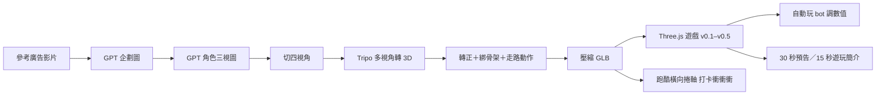
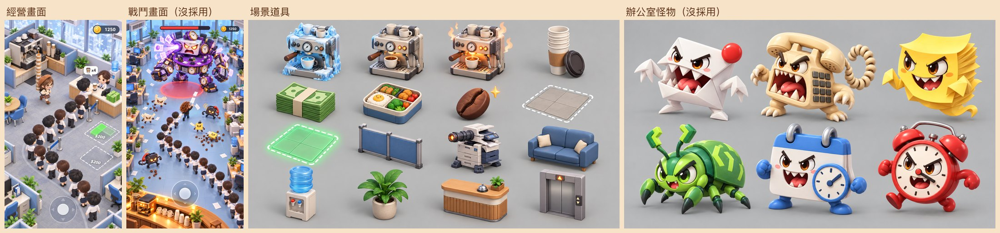
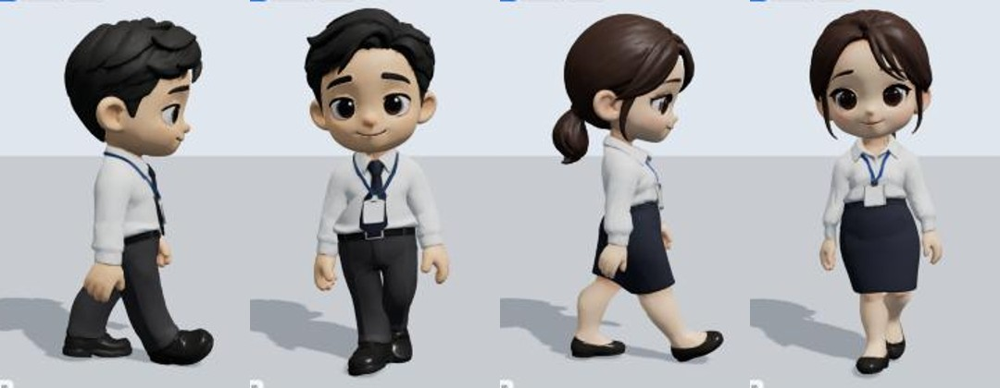
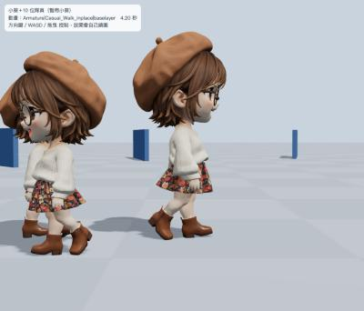
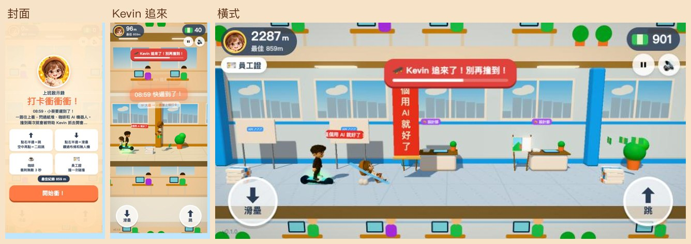

# 《上班啟示錄》製作流程

從一句「把廣告裡的小遊戲改成上班版」開始，到 3D 經營遊戲、宣傳影片，最後再長出一款跑酷橫向捲軸。這份文件記錄每一步怎麼做、用了什麼工具、踩過哪些坑。遊戲、影片和跑酷都在 2026 年 10 月 22 日一天內做完（這份文件寫於 23 日），程式由 Claude Code 撰寫，圖片用 GPT 生成，3D 模型用 Higgsfield（Tripo）轉檔與綁骨架。

- 🎮 上班啟示錄：https://pokemonida99.github.io/office-apocalypse/
- 🏃 打卡衝衝衝（跑酷）：https://pokemonida99.github.io/office-sidescroller/



---

## 1. 開頭：從廣告小遊戲出發

起點是兩支《寒霜啟示錄》的手遊廣告（YouTube `saqdl81dLiw`、Shorts `oAB5AQXflNQ`）。廣告裡的小遊戲是「生產 → 背一疊 → 排隊客人 ×N → 收鈔票 → 踩 $ 格子蓋設施」，節奏快、升級爽。

需求是把它改成辦公室版《上班啟示錄》：

- 主角小葵是剛報到的新人，什麼雜事都要做，一路升職。
- 夥伴：小米、阿傑、Vivi 老闆，加上一群男女上班族 NPC。
- 要做成 3D、可愛公仔風，顏色飽滿溫馨、走路流暢。

第一步先用 GPT 畫企劃圖，抓畫面感：經營畫面、戰鬥畫面、場景道具、辦公室怪物。最後只留下「經營＋升級」這條路，戰鬥與怪物沒有採用。



## 2. 圖片：用 GPT 畫角色三視圖

所有靜態圖都用 GPT（ChatGPT 內建的 Codex CLI）生成：

```bash
codex exec --skip-git-repo-check "Generate one image with your image generation tool: <提示詞>" -i 參考圖.png < /dev/null
```

> 小提醒：`-i` 可以接很多張圖，提示詞要放在 `-i` **前面**，不然會被當成圖片檔名吃掉；同時跑好幾張時，用輸出裡的 session id 去 `~/.codex/generated_images/<session id>/` 找圖，才不會拿錯。

三視圖提示詞的重點（給之後轉 3D 用）：

- 軟膠公仔／黏土質感、大頭 Q 版（頭約佔身高三分之一）、柔和打光、Blender 渲染感。
- 同一角色一張圖並排三個視角：正面、面向右的側面、背面；A-pose、手微張、腳微開、全身入鏡、比例一致。
- 淺灰色素背景、不要文字；**手上不拿東西**（道具之後用程式加），脖子不要扭轉。
- 髮型、眼鏡、衣服照參考圖，不自己加飾品。真人照片只當造型參考，角色一律畫成原創公仔（例如特助 Kevin 是用文字描述畫的）。


## 3. 3D：三視圖 → 會走路的模型

| 步驟 | 做法 | 花費 |
|---|---|---|
| 切圖 | `tools/split_views.py` 把三視圖切成 Tripo 要的四張，順序 **正面、左側（側面鏡像）、背面、右側** | — |
| 轉 3D | Higgsfield `tripo_h3_1_multiview_to_3d`，face_limit 20000–30000 | 9 點 |
| 轉正 | `tools/face_front.py` 把模型臉從 +x 轉到 +z（直接改頂點） | — |
| 綁骨架 | Higgsfield `3d_rigging` 加一段動作：慢走 `walking_2`（692）、小跑 `run_fast_8`（664） | 8 點 |
| 壓縮 | `gltf-transform optimize --compress meshopt --texture-compress webp --texture-size 1024`，5 MB → 約 0.4 MB | — |

整個專案 3D 一共花了約 176 點（七個角色，加上小葵、阿傑的小跑動作）。



踩過的坑：

- **視角順序錯** → 頭變形。一定要正、左、背、右。
- **沒轉正就綁骨架** → 走路像螃蟹橫著走。綁之前先把臉轉到 +z，綁完看側面驗收。
- **步伐怪** → 原本的走路動作原速只走很慢，遊戲裡等於播 9.7 倍快。改成慢走＋小跑兩段依速度混合，播放速度＝移動速度 ÷ 動作原本的步幅速度，腳才會踩實不滑。
- **小跑像在鞠躬** → 原動作前傾 31°，在 Spine02 往後扶正，只留 7°。
- **走路低頭** → 走路動作會讓頭往下 13°，遊戲俯視看不出，影片平視就像在看地上。正確做法是**載入時直接改動畫裡頭部的關鍵格**；如果每格畫完才轉骨頭，three.js 在值沒變時不會重寫骨頭，角度會一直疊上去，頭會閃一下往後仰。
- 量角色身高前要先 `updateMatrixWorld()`，不然會量錯、角色大 2.2 倍。



## 4. 遊戲：Three.js 打雜經營，一路擴增

純 HTML＋Three.js 0.170，不用建置工具。手機直式優先、拖曳畫面移動。

技術骨架：

- `js/world.js`：暖色光、柔光（Bloom）＋飽和度後製、圓角方塊；金屬才給環境貼圖，不然整片泛白。
- `js/assets.js`：載入角色、走跑混合、不滑步。
- `js/stations.js`／`decor.js`／`floors.js`：咖啡機、印表機、攤位、遊樂設施、家具，全部用程式拼出來，每一級都有不同外觀。
- 遊戲內延遲一律用「遊戲時間」排程，不用 `setTimeout`（電腦閒置時瀏覽器會把畫面降到約 2fps）。
- **自動玩 bot**（`tools/bot.js`）：貪婪策略＋格子 A* 尋路，可以一秒跑完幾分鐘的遊戲，用來調數值、抓錯。例如第一年全部升滿約 700 遊戲秒。

### 版本演進

| 版本 | 新增 |
|---|---|
| v0.1 | 茶水間：咖啡機產咖啡、背一疊送給排隊同事、收錢、踩 $200 格子蓋設施 |
| v0.2 | 咖啡機／印表機／電話總機各 5 級（Lv5＝產線、八線客服中心）、小葵升職 9 階、請工讀生、華麗升級特效 |
| v0.3 | 阿傑坐設計部慢慢畫（交稿 +$500）、小米接電話、Vivi 老闆（又貴又沒用的梗）、販賣機、員工餐廳牛肉／雞肉／魚排三攤 |
| v0.4 | 年度業績 Q1–Q4 → 尾牙 → 搬新辦公室（收入永久加成）、採購部（推車、滑板車、磁鐵、8 件裝潢）、突發事件（VIP、午餐尖峰、老闆生日）、自動存檔 |
| v0.4.1 | 主畫面圖示四款可挑（GPT 依角色三視圖畫） |
| v0.4.2 | 攤位拿掉屋頂改桌巾（屋頂會擋住小葵）、升職走更快、開場小葵對話框、離線玩、大頭貼、**操控阿傑老鳥**模式；工讀生自己找事做；小米辦公室；**特助 Kevin**（第二年來說「這個用 AI 就好了」，不揍跑店就被打回 Lv1） |
| v0.5 | **搭電梯**：RF 頂樓遊樂園（咖啡杯、木馬、摩天輪、小火車）、2F 我的辦公室（10 個家具位、多款式、舒適度加成、搬家帶著走） |
| v0.5.1 | 收錢磁鐵改三級、**小米的接電話挑戰**（30 秒反應小遊戲） |


設計原則：不放登入獎勵、儲值、等時間、社交，免費好玩為主；網頁擋兩指放大、文字選取、長按選單，手機玩起來像 App。

## 5. 宣傳影片：真的遊戲畫面＋程式動畫

兩支影片都沒有人聲，全部用程式產生，畫面裡的遊戲片段是**真的遊戲錄下來的**：

1. 遊戲加錄影掛鉤：`G.hold` 停掉畫面迴圈、`G.tick(1/30)` 一格一格推、`G.camAt` 指定鏡頭；bot 自己玩，puppeteer 存下每一格。
2. 影片本身是一個網頁：canvas 畫字卡、轉場、震動、閃光、動態模糊；3D 角色直接載入遊戲的 GLB 畫進影片。
3. 配樂用 Web Audio 離線合成（128 BPM，木琴、鐵琴、收銀機、電話、打字、揍人音效），跟畫面對拍。
4. puppeteer 逐格截圖、ffmpeg 合成 MP4，橫式 1920×1080 和直式 1080×1920 各一支。

- **30 秒動態預告**（showreel 風）：片名、新人小葵、拿貨→送櫃台→收錢→升級、夥伴、Kevin、尾牙、特色。


- **15 秒遊玩簡介**（教學口吻）：拖曳、疊貨送櫃台、升級產線、請夥伴、第二年搭電梯、小米挑戰、揍跑 Kevin，結尾署名「A4不想上班 製作」。


## 6. 再發展：跑酷橫向捲軸《打卡衝衝衝》

同一批角色與 3D 模型，另外做成一款橫向捲軸無盡跑酷（獨立專案 [office-sidescroller](https://github.com/pokemonida99/office-sidescroller)，素材從這裡複製過去，兩邊各改各的）：

- 小葵 08:59 快遲到了，自動往右跑、一路衝上樓打卡。
- 操作只有兩個：點右半邊「跳」（按住跳更高、空中再點二段跳）、點左半邊「滑壘」。
- 障礙：影印紙堆、急件紙箱、打翻的咖啡、滑過來的辦公椅、AI 機器人（可以踩扁）、AI 無人機與「這個用AI就好了」紅布條、可以跳上去跑的辦公桌。
- 收集：鈔票、☕ 咖啡（衝刺無敵）、🪪 員工證（擋一次）。
- 撞到一次，特助 Kevin 會踩 AI 平衡車追上來 9 秒，這段時間再撞到就被抓去開會（遊戲結束）。
- 每 240 m 一區＋打卡鐘：1F 大廳 → 3F 開放辦公區 → 5F 茶水間 → 8F 老闆樓層，一直循環、越跑越快；小米、阿傑、Vivi 在各自的區客串說一句話。
- 角色改成側面鏡頭：模型繞 y 轉 90°；走路低頭、小跑前傾一樣在載入時改動畫關鍵格。



## 7. 工具清單

| 用途 | 工具 |
|---|---|
| 寫程式、測試、出片 | Claude Code（內建瀏覽器實測、手機尺寸截圖） |
| 靜態圖（企劃圖、三視圖、圖示） | GPT（ChatGPT 的 Codex CLI） |
| 轉 3D、綁骨架、走路動作 | Higgsfield（Tripo multiview to 3D、3d_rigging） |
| 遊戲引擎 | Three.js 0.170（GLTFLoader＋MeshoptDecoder、EffectComposer） |
| 模型壓縮 | gltf-transform（meshopt＋webp） |
| 影片輸出 | puppeteer 逐格截圖＋ffmpeg |
| 配樂 | Web Audio OfflineAudioContext 程式合成 |
| 上線 | GitHub Pages（push main 就部署）；service worker 離線快取 |

## 8. 學到的事

- **先畫企劃圖再寫程式**：一張圖就能決定要做經營還是戰鬥，省很多來回。
- **三視圖決定 3D 品質**：視角順序、A-pose、空手、乾淨背景，比調 3D 參數有用。
- **綁骨架前一定先轉正**，綁完看側面走路驗收。
- **用 bot 自動玩調數值**：每次改價格或速度，跑一次就知道整年要玩多久、會不會卡住。
- **鏡頭看得到的東西優先**：攤位屋頂、遮雨棚會擋住主角，改成桌巾和櫃台裝飾。
- **改動畫要改在資料裡**（關鍵格），不要每格硬轉骨頭，否則會閃。
- **小遊戲的獎金要對照主遊戲的收入**，不然玩家會只刷小遊戲。
- **素材複製到新專案再改**，原本的遊戲不會被影響。
